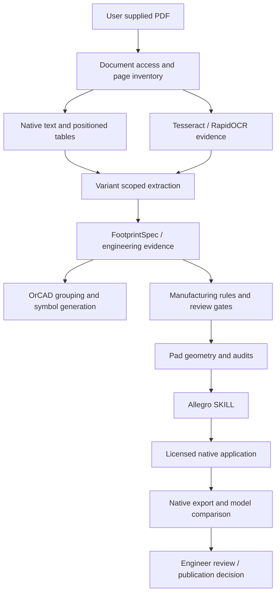

# Architecture and implementation map

## Runtime flow

## Source modules

| Area | Files in src/datasheet_to_allegro | Responsibilities / limits |
|---|---|---|
| Orchestration | pipeline.py, universal_extractor.py, workflow.py | PDF inspection, candidate selection, model assembly; the universal extractor is large and needs modularization |
| PDF evidence | document_access.py, pdf_evidence.py, mechanical_page_plan.py | Native access, page prioritization and evidence inventory |
| OCR | ocr_engine.py, ocr_crosscheck.py | Installed languages, fallback, caching and numeric cross-check; unified coordinate/transform evidence remains incomplete |
| Tables | positioned_tables.py, dimension_tables.py, column_pin_tables.py, pin_table_schema.py, structured_pin_tables.py, mux_tables.py | Physical cells, headers, units, pin roles, multiplexed functions; merged/cross-page scope still needs work |
| Source reconciliation | reference_pin_evidence.py, pin_reconciliation.py | Compare pin tables/maps and retain unresolved differences |
| Dimensions | spatial_dimensions.py, dimension_graph.py, vector_tolerances.py, circular_dimensions.py | Associate labels with drawing features; partial structural coverage, not general drawing understanding |
| Models | models.py, engineering_ir.py | Measurements, evidence, package identity, unresolved items and review metadata |
| CAD geometry | geometry.py, allegro.py, native_polygon.py, naming.py | Geometry, SKILL, pad naming and native polygons |
| Gates | engineering_checks.py, validation.py, generation_gate.py, draft_readiness.py, audit.py | Input checks, model/geometry checks, review vs release eligibility |
| Manufacturing | industry_defaults.py, manufacturing.py | Parameterized calculations; calculated values are not manufacturer recommendations or automatically approved standards |
| Native verification | native_verification.py, actual_verification.py, cadence_compatibility.py | Launch generation, export actual database, compare dimensions/counts/properties and track exact CAD version |
| Symbols | orcad_library.py, symbol_reference_policy.py | Functional grouping, multipart layout and electrical-type handling |
| Design comparison | connectivity_review.py, capture_reference_rules.py, capture_audit_entry.py | Optional schematic/board attribute and connectivity comparisons |
| Public boundary | reference_defaults.py | Private board-derived policy deliberately replaced by a no-op adapter |
| UI / exports | desktop.py, ui/, render.py, cli.py | Windows desktop bridge, CLI and review bundles |
| External drawings | package_documents.py | Explicit two-file association; unique document-declared identifiers plus geometry/topology checks; no web downloader |

## Evidence contract

A measurement should retain source text, unit, numeric bounds, page, region, extraction method and confidence. Component terminal, PCB copper, solder-mask opening and paste opening are different roles. File hashes identify inputs for traceability; they must not choose answers.

Document evidence -> interpreted model -> calculated manufacturing geometry -> actual CAD readback are separate boundaries. An upstream wrong interpretation can survive every downstream consistency check. Draft eligibility, actual generation, native readback and engineering approval therefore need separate status fields.

## Current deployment boundaries

- Python inspection and synthetic tests can run without Cadence.
- Native Allegro and Capture paths require Windows/licensed applications and version-specific behavior.
- The desktop is a pywebview bridge; long operations use background work and status reporting.
- Existing CAD catalogs are external inputs. They are not distributed and are not proof of source-PDF correctness.
- Circle-role algorithms currently expose reusable evidence functions; they do not automatically eliminate default-path HOLDs.
- The official-drawing path accepts explicitly supplied local PDFs. Revision/latestness is not automatically verified.

## Refactoring direction

Separate document access, token coordinates, table scope, semantic dimensions, package modeling and CAD adapters behind typed contracts. Preserve provenance and regression behavior at each boundary. Avoid a wholesale rewrite that discards previously successful structural handling.
